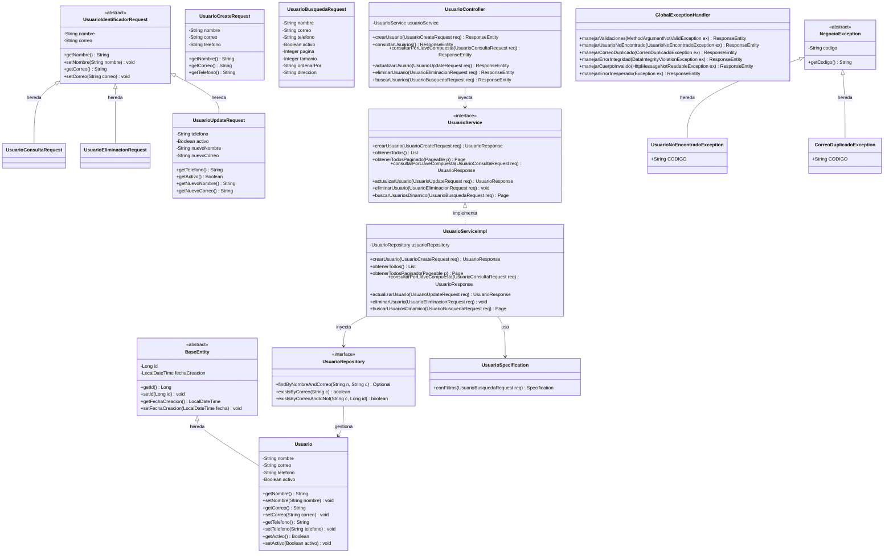

# API REST para la Administración de Usuarios

**Asignatura:** Introducción a Aplicaciones Web Progresivas (PWA)  
**Carrera:** Desarrollo de Software Multiplataforma  
**Alumno:** Gerardo Manzano Villafaña  
**Grupo:** GIDS6102  
**Maestro:** Francisco Hasani Barrera  

---

## 1. Descripción del proyecto
Este proyecto consiste en el desarrollo de una API REST empresarial para la gestión y administración de usuarios, construida bajo estrictas directrices de arquitectura en capas, principios de Programación Orientada a Objetos (POO), validación exhaustiva de datos, manejo centralizado de errores y consultas dinámicas seguras.

### Restricciones obligatorias cumplidas:
* 🚫 **Ausencia total de `@PathVariable`:** Ningún identificador ni parámetro se envía en la URL.
* 🚫 **Ausencia total de `@RequestParam`:** Cero parámetros de consulta en URL.
* 📦 **Transferencia estricta mediante Request DTOs:** Toda entrada de datos se procesa mediante objetos DTO anotados con `@RequestBody`.
* 🛡️ **Validación declarativa con Bean Validation:** Uso estricto de `@Valid`, `@NotBlank`, `@Email`, `@Pattern`, `@Size` y `@NotNull` según su propósito semántico específico.
* 🚦 **Manejo global de excepciones:** Implementación centralizada con `@RestControllerAdvice` en `GlobalExceptionHandler.java` para capturar errores de validación, reglas de negocio e integridad sin exponer datos sensibles.
* 🔍 **Llave compuesta para localización:** Se utiliza la tupla `(nombre, correo)` como criterio compuesto para operaciones individuales (consulta, actualización y eliminación), preservando el `id` autoincremental en base de datos.
* ⚡ **Búsquedas dinámicas seguras con JPA:** Uso de `JpaSpecificationExecutor<Usuario>` y `Specification<Usuario>` para combinar filtros opcionales (coincidencia parcial de nombre, teléfono, correo y estado activo) sin crear múltiples endpoints ni concatenar SQL.
* 🔒 **Desacoplamiento de entidades JPA:** Nunca se exponen entidades de persistencia a los clientes; todas las respuestas utilizan Response DTOs (`UsuarioResponse`, `ApiResponse<T>`).

---

## 2. Tecnologías utilizadas
* **Lenguaje:** Java 21 (LTS) / compatible con Java 17+
* **Framework:** Spring Boot 3.3.4
  * Spring Web (Spring MVC REST)
  * Spring Data JPA / Hibernate 6.x
  * Spring Boot Starter Validation (Hibernate Validator 8.x)
* **Base de datos:** PostgreSQL 17 / PostgreSQL 14+
* **Documentación interactiva:** Springdoc OpenAPI 2.6.0 (Swagger UI 3)
* **Gestor de dependencias y construcción:** Apache Maven 3.9+
* **Pruebas automatizadas:** JUnit 5, MockMvc, AssertJ, Hamcrest y H2 Database en memoria para pruebas continuas.

---

## 3. Configuración de PostgreSQL

### 3.1. Requisitos previos
Tener en ejecución el servicio de PostgreSQL en el puerto `5432`.

### 3.2. Creación de la base de datos y usuario
Desde la consola interactiva `psql` o mediante `pgAdmin 4`:

```sql
-- Crear la base de datos
CREATE DATABASE db_usuarios;

-- Conectarse a la base de datos
\c db_usuarios;
```

### 3.3. Estructura de la tabla `usuarios`
El proyecto incluye el archivo `database.sql` en la raíz. La definición DDL con restricciones de integridad y optimización es:

```sql
CREATE TABLE usuarios (
    id BIGSERIAL PRIMARY KEY,
    nombre VARCHAR(100) NOT NULL,
    correo VARCHAR(150) NOT NULL,
    telefono VARCHAR(15) NOT NULL,
    activo BOOLEAN NOT NULL DEFAULT TRUE,
    fecha_creacion TIMESTAMP NOT NULL DEFAULT CURRENT_TIMESTAMP,
    CONSTRAINT uk_usuarios_correo UNIQUE (correo)
);

-- Índice para optimizar consultas por llave compuesta
CREATE INDEX idx_usuarios_nombre_correo ON usuarios (nombre, correo);
```

### 3.4. Credenciales en `application.properties`
El archivo `src/main/resources/application.properties` viene configurado por defecto:
```properties
spring.datasource.url=jdbc:postgresql://localhost:5432/db_usuarios
spring.datasource.username=postgres
spring.datasource.password=postgres
```
*(Puedes definir la variable de entorno `DB_PASSWORD` para utilizar una contraseña personalizada).*

---

## 4. Instrucciones de ejecución

### Opción A: Desde IntelliJ IDEA
1. Abrir la carpeta `api-usuarios` en IntelliJ IDEA.
2. Esperar a que IntelliJ sincronice las dependencias del `pom.xml`.
3. Navegar a `src/main/java/com/proyecto/usuarios/UsuariosApplication.java`.
4. Hacer clic en el botón verde **Run (Play)** ▶️.

### Opción B: Mediante terminal / Maven
Ejecutar en la raíz del proyecto:
```bash
mvn spring-boot:run
```

### Acceso a Swagger UI y Documentación OpenAPI
Una vez iniciada la aplicación, ingresar en el navegador:
* **Swagger UI:** [http://localhost:8080/swagger-ui.html](http://localhost:8080/swagger-ui.html)
* **OpenAPI JSON:** [http://localhost:8080/api-docs](http://localhost:8080/api-docs)

---

## 5. Endpoints implementados

| Método | Endpoint | Descripción | Body Requerido | Código Exitoso |
| :--- | :--- | :--- | :--- | :--- |
| **POST** | `/api/v1/usuarios` | Crear / registrar nuevo usuario | `UsuarioCreateRequest` | `201 Created` |
| **GET** | `/api/v1/usuarios` | Listado general de usuarios | *Ninguno (sin @RequestParam)* | `200 OK` |
| **POST** | `/api/v1/usuarios/consulta` | Consultar usuario por llave compuesta | `UsuarioConsultaRequest` | `200 OK` |
| **PATCH**| `/api/v1/usuarios/actualizacion` | Actualización parcial de usuario | `UsuarioUpdateRequest` | `200 OK` |
| **DELETE**| `/api/v1/usuarios/eliminacion` | Eliminar usuario por llave compuesta | `UsuarioEliminacionRequest` | `200 OK` |
| **POST** | `/api/v1/usuarios/busqueda` | Búsqueda dinámica con filtros combinables | `UsuarioBusquedaRequest` | `200 OK` |

---

## 6. Ejemplos de peticiones y respuestas

### 6.1. Crear usuario (POST `/api/v1/usuarios`)
**Petición:**
```bash
curl -X POST http://localhost:8080/api/v1/usuarios \
  -H "Content-Type: application/json" \
  -d '{
    "nombre": "Juan Pérez",
    "correo": "juan.perez@correo.com",
    "telefono": "4771234567"
  }'
```
**Respuesta Exitosa (HTTP 201 Created):**
```json
{
  "mensaje": "Usuario registrado correctamente.",
  "datos": {
    "id": 1,
    "nombre": "Juan Pérez",
    "correo": "juan.perez@correo.com",
    "telefono": "4771234567",
    "activo": true,
    "fechaCreacion": "2026-10-14T10:30:00"
  }
}
```

**Respuesta si el correo ya existe (HTTP 409 Conflict):**
```json
{
  "codigo": "CORREO_DUPLICADO",
  "mensaje": "El correo ya se encuentra registrado. Intente con otro correo."
}
```

**Respuesta si falla la validación (HTTP 400 Bad Request):**
```json
{
  "codigo": "DATOS_INVALIDOS",
  "mensaje": "Verifique la información capturada e intente nuevamente.",
  "errores": {
    "nombre": "El nombre es obligatorio y no puede contener solo espacios.",
    "correo": "El correo electrónico no tiene un formato válido.",
    "telefono": "El teléfono debe contener exactamente 10 dígitos."
  }
}
```

---

### 6.2. Consultar usuarios registrados (GET `/api/v1/usuarios`)
**Petición:**
```bash
curl -X GET http://localhost:8080/api/v1/usuarios
```
**Respuesta Exitosa (HTTP 200 OK):**
```json
{
  "mensaje": "Usuarios consultados exitosamente.",
  "datos": [
    {
      "id": 1,
      "nombre": "Juan Pérez",
      "correo": "juan.perez@correo.com",
      "telefono": "4771234567",
      "activo": true,
      "fechaCreacion": "2026-10-14T10:30:00"
    }
  ]
}
```

---

### 6.3. Consultar usuario por llave compuesta (POST `/api/v1/usuarios/consulta`)
**Petición:**
```bash
curl -X POST http://localhost:8080/api/v1/usuarios/consulta \
  -H "Content-Type: application/json" \
  -d '{
    "nombre": "Juan Pérez",
    "correo": "juan.perez@correo.com"
  }'
```
**Respuesta Exitosa (HTTP 200 OK):**
```json
{
  "id": 1,
  "nombre": "Juan Pérez",
  "correo": "juan.perez@correo.com",
  "telefono": "4771234567",
  "activo": true,
  "fechaCreacion": "2026-10-14T10:30:00"
}
```

**Respuesta si no existe el usuario (HTTP 404 Not Found):**
```json
{
  "codigo": "USUARIO_NO_ENCONTRADO",
  "mensaje": "No existe un usuario con el nombre y correo electrónico proporcionados."
}
```

---

### 6.4. Actualizar usuario parcialmente (PATCH `/api/v1/usuarios/actualizacion`)
**Petición:**
```bash
curl -X PATCH http://localhost:8080/api/v1/usuarios/actualizacion \
  -H "Content-Type: application/json" \
  -d '{
    "nombre": "Juan Pérez",
    "correo": "juan.perez@correo.com",
    "telefono": "4779876543",
    "activo": true
  }'
```
**Respuesta Exitosa (HTTP 200 OK):**
```json
{
  "mensaje": "Usuario actualizado correctamente.",
  "datos": {
    "id": 1,
    "nombre": "Juan Pérez",
    "correo": "juan.perez@correo.com",
    "telefono": "4779876543",
    "activo": true,
    "fechaCreacion": "2026-10-14T10:30:00"
  }
}
```

---

### 6.5. Eliminar usuario por llave compuesta (DELETE `/api/v1/usuarios/eliminacion`)
**Petición:**
```bash
curl -X DELETE http://localhost:8080/api/v1/usuarios/eliminacion \
  -H "Content-Type: application/json" \
  -d '{
    "nombre": "Juan Pérez",
    "correo": "juan.perez@correo.com"
  }'
```
**Respuesta Exitosa (HTTP 200 OK):**
```json
{
  "mensaje": "Usuario eliminado correctamente."
}
```

---

### 6.6. Búsqueda dinámica con Specification (POST `/api/v1/usuarios/busqueda`)
Permite combinar cualquier combinación de filtros opcionales (los campos omitidos o en null se excluyen de la consulta):
**Petición:**
```bash
curl -X POST http://localhost:8080/api/v1/usuarios/busqueda \
  -H "Content-Type: application/json" \
  -d '{
    "nombre": "Juan",
    "correo": null,
    "telefono": null,
    "activo": true,
    "pagina": 0,
    "tamanio": 10
  }'
```
**Respuesta Exitosa (HTTP 200 OK):**
```json
{
  "mensaje": "Búsqueda realizada exitosamente.",
  "datos": {
    "content": [
      {
        "id": 1,
        "nombre": "Juan Pérez",
        "correo": "juan.perez@correo.com",
        "telefono": "4771234567",
        "activo": true,
        "fechaCreacion": "2026-10-14T10:30:00"
      }
    ],
    "pageable": {
      "pageNumber": 0,
      "pageSize": 10
    },
    "totalElements": 1,
    "totalPages": 1
  }
}
```

---

## 7. Explicación del consumo de servicios REST
1. **Protocolo y Formato:** Todos los servicios operan bajo HTTP/1.1 y HTTP/2, intercambiando datos en formato `application/json`.
2. **Métodos HTTP Semánticos:**
   * `POST`: Creación de nuevos registros y ejecución de consultas complejas / búsquedas dinámicas con cuerpo JSON.
   * `GET`: Recuperación de colecciones de datos sin efectos secundarios en el servidor.
   * `PATCH`: Modificación parcial de recursos existentes.
   * `DELETE`: Supresión de recursos identificados mediante cuerpo de solicitud.
3. **Códigos de Estado HTTP Utilizados:**
   * `200 OK`: Solicitud exitosa con contenido devuelto.
   * `201 Created`: Creación exitosa de un nuevo recurso.
   * `400 Bad Request`: Error de validación en los datos enviados o JSON mal formado.
   * `404 Not Found`: Recurso no encontrado bajo la llave compuesta proporcionada.
   * `409 Conflict`: Violación de unicidad de correo o regla de integridad.
   * `500 Internal Server Error`: Fallo no previsto en el servidor con mensaje controlado.

---

## 8. Evidencia de pruebas realizadas
El proyecto cuenta con una suite completa de pruebas de integración automatizadas en [UsuarioControllerTest.java](file:///C:/Users/gerar/IdeaProjects/api-usuarios/src/test/java/com/proyecto/usuarios/controller/UsuarioControllerTest.java):

* `testCrearUsuarioExitoso()`: Valida respuesta HTTP 201 y estructura completa con ID y fecha generada.
* `testCrearUsuarioCorreoDuplicado()`: Valida HTTP 409 Conflict y código `CORREO_DUPLICADO`.
* `testCrearUsuarioDatosInvalidos()`: Valida Bean Validation con HTTP 400 y mapeo detallado de campos con error.
* `testConsultarUsuarios()`: Valida listado general HTTP 200 sin parámetros de URL.
* `testConsultarPorLlaveCompuestaExitosa()`: Valida localización con nombre + correo.
* `testConsultarPorLlaveCompuestaNoEncontrado()`: Valida excepción `UsuarioNoEncontradoException` y código 404.
* `testActualizarUsuarioExitoso()`: Valida PATCH parcial sin sobrescribir valores omitidos.
* `testEliminarUsuarioExitoso()`: Valida eliminación física y confirmación HTTP 200 estructurada.
* `testBusquedaDinamica()`: Valida filtros dinámicos con `JpaSpecificationExecutor`.

Para ejecutar las pruebas:
```bash
mvn test
```

---

## 9. Diagrama de clases

El modelo de clases cumple estrictamente con los conceptos de **Clases Abstractas, Interfaces, Herencia y Polimorfismo**:

* **Clases Abstractas:** 
  * `BaseEntity`: Encapsula los campos de auditoría `id` y `fechaCreacion` para persistencia JPA.
  * `UsuarioIdentificadorRequest`: Encapsula la llave compuesta de búsqueda `nombre` y `correo`.
  * `NegocioException`: Base polimórfica para todas las excepciones de dominio.
* **Interfaces:**
  * `UsuarioService`: Desacopla la definición del contrato respecto a la implementación.
  * `UsuarioRepository`: Extiende `JpaRepository` y `JpaSpecificationExecutor`.
* **Polimorfismo y Herencia:**
  * `Usuario` hereda de `BaseEntity`.
  * `UsuarioConsultaRequest`, `UsuarioEliminacionRequest` y `UsuarioUpdateRequest` heredan de `UsuarioIdentificadorRequest`.
  * `UsuarioNoEncontradoException` y `CorreoDuplicadoException` heredan de `NegocioException`.


